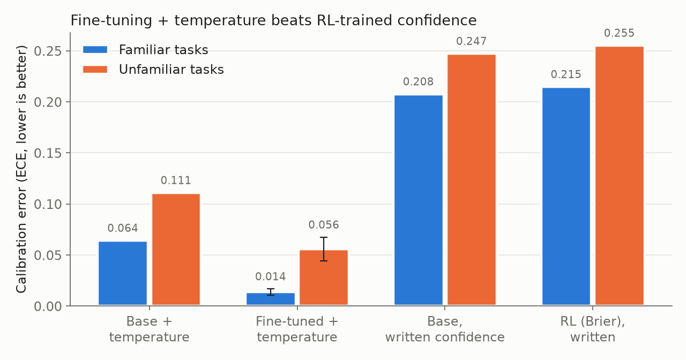
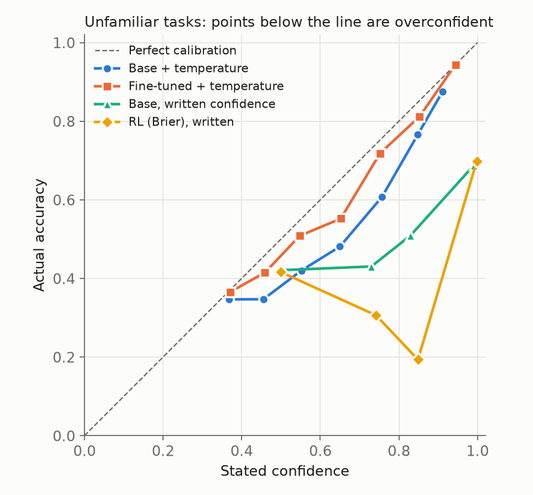

# Calibrated Decisions

**Does RL training make an LLM decision model's confidence more trustworthy than cheap fixes?**

TypeSafe's Jev decision model is trained with "RLCD" — reinforcement learning for calibrated
decisions — and presents RL as the way to get honest confidence (the recipe isn't public).
This project runs a controlled test on Qwen3-1.7B: same model, same training questions, three
ways to get confidence, evaluated on familiar tasks **and on task types the model never saw**.

**Result:** plain fine-tuning + one-parameter temperature scaling gave by far the most
trustworthy confidence — **ECE 0.056 ± 0.011 on unseen tasks** (3 seeds), half the error of the
untrained model + temperature (0.111). RL on written confidence (0.255) barely improved on the
untrained model (0.247): it learned the output format and gained accuracy, but collapsed to
near-identical confident answers within ~100 steps and stopped learning.



## Results (test set)

| method | acc (fam / unseen) | **ECE (fam / unseen)** | Brier (fam / unseen) |
|---|---|---|---|
| base + temperature (T = 9.89) | 0.700 / 0.617 | 0.064 / 0.111 | 0.174 / 0.222 |
| **fine-tuned + temperature** | **0.794 / 0.642** | **0.014 ± 0.003 / 0.056 ± 0.011** | **0.121 / 0.194** |
| base, written confidence | 0.641 / 0.599 | 0.208 / 0.247 | 0.269 / 0.296 |
| RL (GRPO, Brier reward), written | 0.679 / 0.619 | 0.215 / 0.255 | 0.246 / 0.294 |

ECE = expected calibration error (10 bins; lower is better). Fine-tuned row: ECE is mean ± std
over 3 training seeds; other columns are seed 0. Untrained Qwen3-1.7B, read raw, is badly
overconfident: average confidence 0.97–0.98 at 62–70% accuracy (ECE 0.27 / 0.36).



## Setup

- **Model:** Qwen3-1.7B, thinking off, LoRA (r = 16, 17.4M trainable params), trained and
  evaluated locally on an Apple-silicon laptop (MPS).
- **Tasks** — every question becomes lettered options with a single-letter answer, option
  order shuffled (kills position bias):
  - familiar (train / calibration / test): BoolQ, MNLI, Banking77 (1-of-5 intent routing), MMLU
  - unseen (test only — never trained on, never used to fit anything): PubMedQA, ARC-Challenge,
    Climate-FEVER
  - leak checks: MMLU's `auxiliary_train` contains ARC, so it's excluded; MMLU cross-split
    duplicates removed; zero question overlap between splits.
- **Two ways to read confidence:**
  - *option spread* — one forward pass, probability on each option letter (summing spellings
    like `A` / ` A`), renormalized over the options. How open Jev-style models work.
  - *written* — the model writes `answer: B | confidence: 0.85`; parsed, format failures
    count as wrong at confidence 1.0.
- **Methods:**
  - *temperature scaling* — one global T fit by NLL on familiar calibration data only.
  - *fine-tuning* — cross-entropy on the option spread, 1,000 steps × 8 questions.
  - *RL* — GRPO, 8 samples per question, reward = correct − (confidence − correct)² (a proper
    scoring rule, as in RLCR), checkpoint picked by calibration-split Brier.
- **Fairness:** every method learns only from the familiar training split; checkpoints and T are
  chosen on calibration data; test is touched once.

## Notes

- **RL on the option spread is the wrong design.** If "confidence" is the same probability used
  to sample the answer, a Brier reward stops being proper — a model that's right 70% of the time
  maximizes expected reward by reporting 0.9. We ran it; calibration got worse. That's why the
  RL arm uses a separately written confidence.
- **Entropy collapse.** Written-confidence RL improved calibration Brier for ~100 steps, then the
  model began writing the same answer and confidence in all 8 samples (90–98% of groups gave
  zero learning signal) and calibration drifted back.
- **Caveats:** one model size; RL is one seed with one set of hyperparameters (sampling
  temperature 1.3, LR 1e-5) — a better-tuned RL run could do better; tasks are public
  benchmarks, not production decisions.

## Related work

- RLCR — *Beyond Binary Rewards: Training LMs to Reason About Their Uncertainty* (arXiv
  2507.16806): calibration-reward RL **with** reasoning; this project tests single-step decisions.
- Open Jev-style models (decider, s1-decision-model, lev, opendecider) read option probabilities
  and calibrate post hoc, consistent with the result here.

## Reproduce

```bash
python -m venv .venv && .venv/bin/pip install -r requirements.txt matplotlib
python data.py                                   # build splits
python eval_spread.py Qwen/Qwen3-1.7B cal test   # base model, option spread
python eval_written.py Qwen/Qwen3-1.7B test      # base model, written confidence
python sft.py --seed 0 --out checkpoints/sft     # fine-tune (also --seed 1/2)
python eval_spread.py checkpoints/sft cal test
python rl_written.py --reward brier --steps 1000 --out checkpoints/rlw_brier
python eval_written.py checkpoints/rlw_brier test
python report.py                                 # results table
python make_figures.py                           # figures/
```
